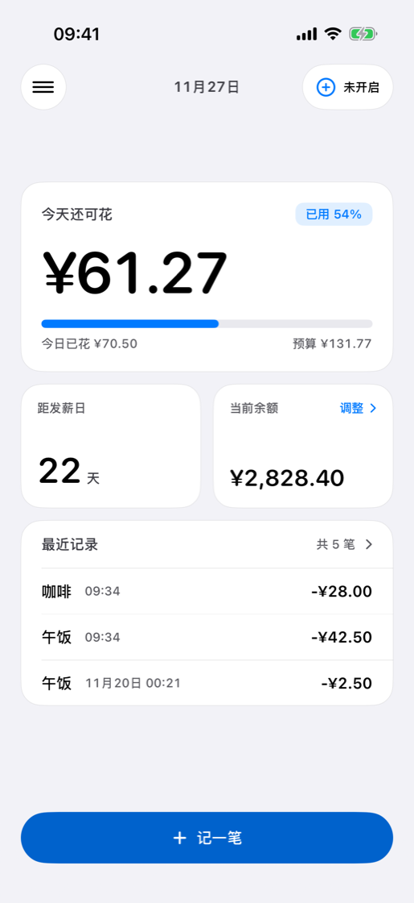
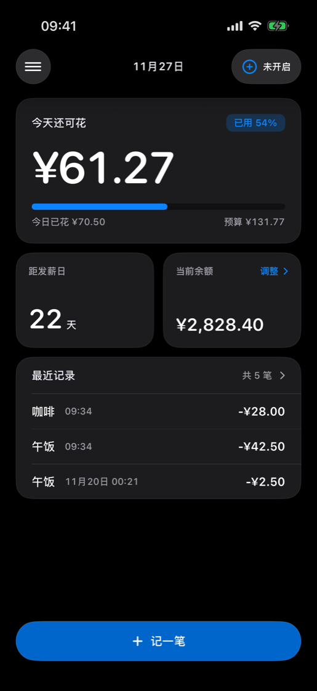
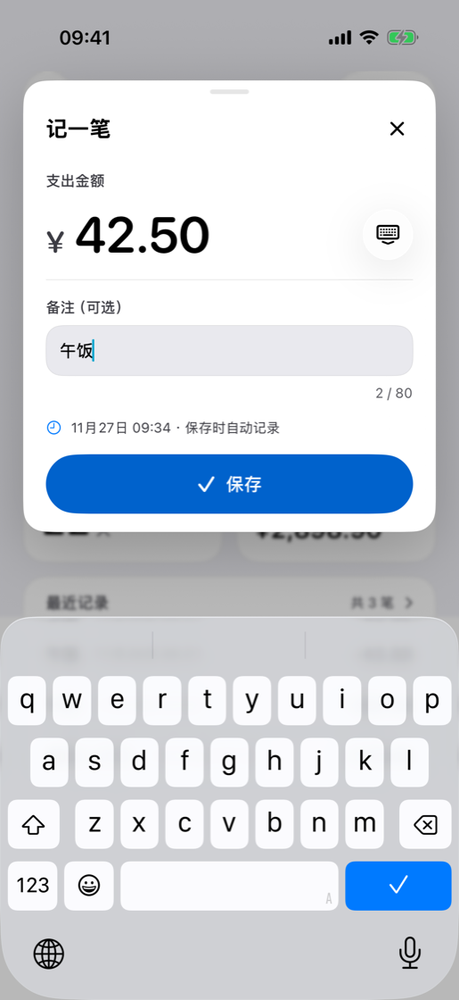
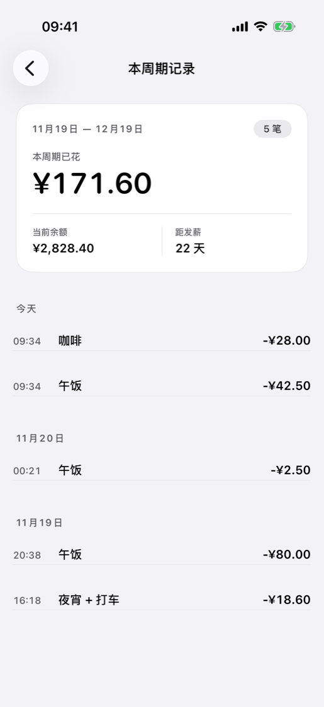
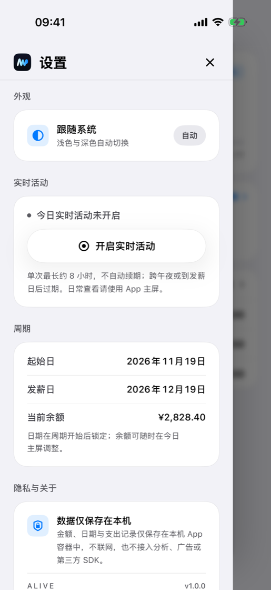

<div align="center">
  
  <h1>ALIVE</h1>
  <p><strong>A minimalist personal daily budget app for iOS built around a single question: <em>"How much can I spend today?"</em></strong></p>
  <p>
    
    
    
    
  </p>
  <p>
    <strong>English</strong> | <a href="README.zh-CN.md">简体中文</a>
  </p>
</div>

---

## Overview

**ALIVE** (*staying alive until payday*) avoids the clutter of traditional finance dashboards, categories, and complex charts. Instead, it continuously translates your remaining balance and days until your next payday into a clear **daily disposable allowance**, paired with a modular **Bento-grid home screen** and **Dynamic Island / Lock Screen Live Activity** quick entry.

---

## Screenshots

| Today (Light) | Today (Dark) | Quick Entry | Cycle History | Settings Drawer |
| :---: | :---: | :---: | :---: | :---: |
|  |  |  |  |  |

---

## Key Features

- **Daily Allowance Engine**: Computes `Today's Allowance` from your current balance over the half-open cycle `[Start Date, Payday)` using a fixed `Asia/Shanghai` calendar day boundary. Supports past, today, and future start dates (`pending` countdown state).
- **Bento Grid Home Screen**:
  - **Hero Tile**: Displays today's available (or overspent) amount, usage percentage badge, and progress bar.
  - **Metrics Grid**: Side-by-side tiles for **Days Until Payday** and **Current Balance** (tap directly to adjust balance).
  - **Recent Activity Tile**: Clean summary of recent expenses with one-tap navigation to full cycle history.
- **Frictionless Quick Entry**: Top-unfolding floating card with automatic decimal-pad focus, optional 80-character note, and real-time validation. Full editing and deletion with confirmation are available in cycle history.
- **Balance Overrides & Automatic Rollover**: Adjust your remaining balance anytime to recalculate daily allowance immediately; automatically archives completed cycles and rolls over remaining balance at payday midnight.
- **Dynamic Island & Lock Screen Live Activity**:
  - **Compact & Minimal**: Features the continuous ALIVE ribbon monogram and compact remaining amount; tapping opens the Today screen (`alive://today`).
  - **Expanded Micro-Bento**: Long-press reveals a 2-step integer keypad (`0–9`, backspace, next) and quick-save tags (`LiveActivityIntent` executed idempotently in the App process).
  - **Lock Screen Continuity**: Tapping the Lock Screen activity opens the in-app top continuity layer (`alive://live-entry`) for free-text notes.

---

## Core Formula

For active cycles (and setups starting today or earlier):

```text
todayBudget    = max(0, currentBalance) / max(1, calendarDaysUntilPayday)
todayAvailable = todayBudget - todaySpent
```

- All monetary math uses exact integer cents / `Decimal` (no binary floating-point accumulation).
- `todayBudget` stays anchored for the local day; overspending triggers an `overspent` state without blocking further entries, and the remaining balance is re-allocated the next day.

---

## Architecture & Project Structure

- **Target Baseline**: iOS 26.0+, iPhone only, Swift 6 strict concurrency
- **Frameworks**: SwiftUI, SwiftData, ActivityKit, WidgetKit, Swift Testing
- **Project Generator**: XcodeGen ([project.yml](project.yml))

```text
ALIVE/
├── Alive/                 # Main SwiftUI App (Screens, AppModel, DesignSystem, AppIcons)
├── AliveCore/             # Shared static framework (Domain models, BudgetCalendar, BudgetResolver, SwiftData store, Formatting, Deep links)
├── AliveWidgets/          # WidgetKit extension (Live Activity UI & Dynamic Island 2-step entry)
├── AliveTests/            # Swift Testing suite (42 unit tests across 3 suites)
├── Shared/                # Cross-target LiveActivityIntent definitions
├── docs/screenshots/      # App screenshots for documentation
└── project.yml            # XcodeGen specification
```

---

## Getting Started

### Prerequisites

- Xcode 26+ (iOS 26.0+ SDK)
- [XcodeGen](https://github.com/yonaskolb/XcodeGen) (only needed when modifying `project.yml` or targets)

### Generate Project & Build

```bash
xcodegen generate

xcodebuild -project ALIVE.xcodeproj -scheme Alive \
  -destination 'platform=iOS Simulator,name=iPhone 17 Pro,OS=26.5' \
  -configuration Debug \
  -derivedDataPath artifacts/local-verification/DerivedData \
  build
```

### Run Unit Tests (`AliveTests`)

```bash
xcodebuild -project ALIVE.xcodeproj -scheme Alive \
  -destination 'platform=iOS Simulator,name=iPhone 17 Pro,OS=26.5' \
  -configuration Debug \
  -derivedDataPath artifacts/local-verification/DerivedData \
  test
```

---

## Privacy & Local-First Design

- **100% On-Device**: All financial amounts, paydays, and expense records stay strictly inside the app's local SwiftData sandbox (`Library/Application Support/ALIVE/Database/Alive.store`).
- **Zero Telemetry**: No accounts, no cloud sync, no network requests, no analytics, and no third-party SDKs.
- **No App Group**: Live Activity state is pushed read-only via `ActivityContent`, while Dynamic Island intents execute directly in the App process.
