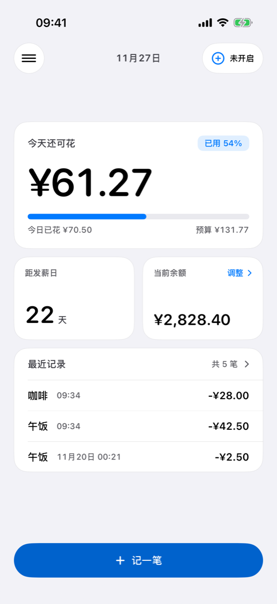
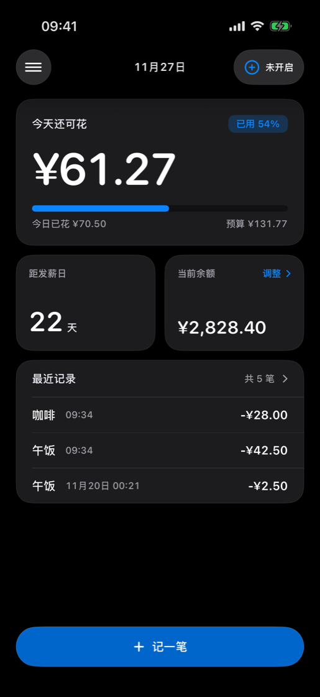
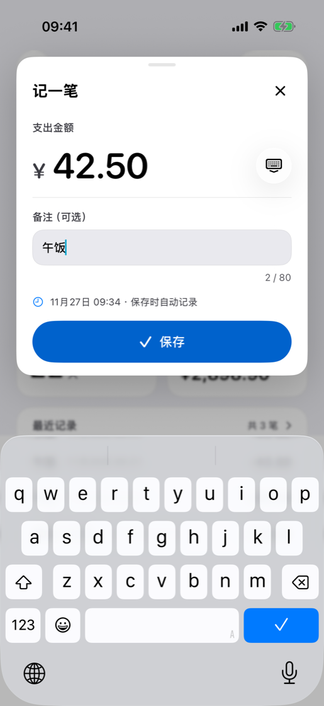
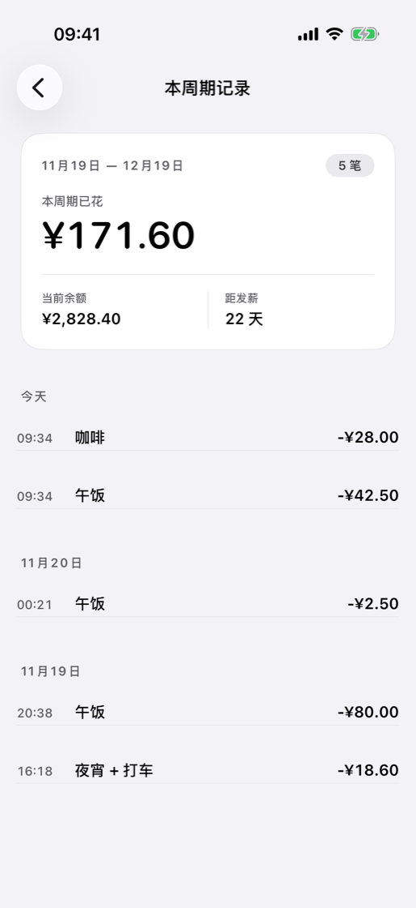
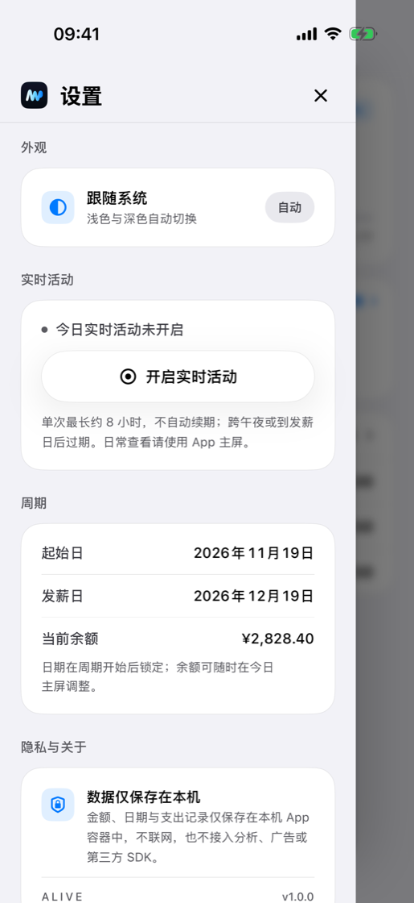
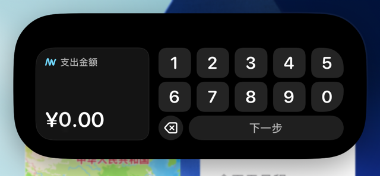
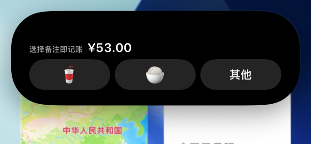
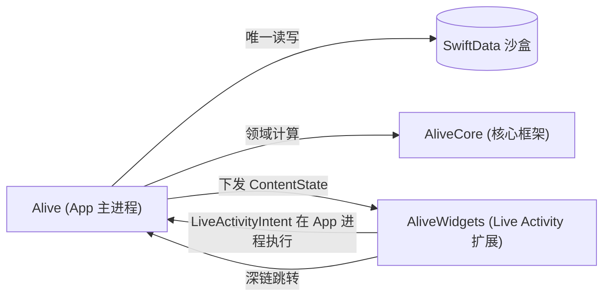

<div align="center">
  
  <h1>ALIVE</h1>
  <p><strong>围绕「今天还可花」设计的极简 iOS 个人每日预算应用</strong></p>
  <p>
    
    
    
    
    <a href="LICENSE"></a>
  </p>
  <p>
    <a href="README.md">English</a> | <strong>简体中文</strong>
  </p>
</div>

---

## 简介

**ALIVE**（寓意「活着」）不追求传统记账工具的繁杂分类、图表与报表，而是聚焦一个核心问题：**「今天还能花多少」**。应用将当前余额按日历天数自动分配到发薪日前的每一天，结合 **Bento 便当盒主屏** 与 **灵动岛 / 锁屏实时活动**，大幅降低日常查看与记账摩擦。

---

## 应用截图

| 今日主屏（浅色） | 今日主屏（深色） | 快速记账卡片 | 本周期记录 | 设置抽屉 |
| :---: | :---: | :---: | :---: | :---: |
|  |  |  |  |  |

### 灵动岛极速记账（无需打开 App）

在任意界面长按灵动岛，即可通过 **Micro-Bento 岛内两步交互** 在 2 秒内完成记账；所有动作由 `LiveActivityIntent` 直接在 App 进程幂等写入，无需 App Group：

| 1. 岛内 Micro-Bento 整数键盘 | 2. 点选标签即刻保存 |
| :---: | :---: |
|  |  |

---

## 核心特性

- **每日可用额度引擎**：基于左闭右开周期 `[起始日, 发薪日)` 与固定北京时间（`Asia/Shanghai`）日历日，实时计算「今天还可花」或未来起始日的「预计每日额度」（`pending` 待开始状态）。
- **Bento 便当盒主屏**：
  - **主格**：展示今日可用（或超支）金额、已用百分比徽章与进度条。
  - **双列指标格**：左右并排呈现 **距发薪日天数** 与 **当前余额**（轻点余额方格即可直接调整）。
  - **最近记录格**：清晰展示近期支出流水，点击即可进入本周期完整记录页。
- **轻量快速记账**：从屏幕顶部展开悬浮记账卡片，自动聚焦数字键盘，支持最多 80 字可选备注与实时校验；历史流水页支持支出编辑与确认删除。
- **余额修正与周期自动结转**：支持随时修正当前剩余金额并实时重算今日预算；到达发薪日 00:00 自动归档旧周期并结转余额。
- **灵动岛与锁屏实时活动**：
  - **紧凑态与最小态**：展示 ALIVE 连笔流体符号与紧凑金额，短按直达今日主屏（`alive://today`）。
  - **展开态 Micro-Bento**：长按进入两步整数记账（`0–9` 防裁切数字键、退格、下一步 → 三标签点选直存），由 `LiveActivityIntent` 在 App 进程幂等写入。
  - **锁屏连续记账层**：轻点锁屏活动整卡通过 `alive://live-entry` 进入 App 顶部连续记账层输入自由备注。

---

## 核心计算口径

进行中周期（及起始日不晚于今天的首次设置）：

```text
今日预算   = max(0, 当前余额) ÷ max(1, 今天到发薪日的日历日数)
今天还可花 = 今日预算 − 今日已支出
```

- 内部金额全程使用最小货币单位整数（分）与 `Decimal` 精确计算，禁止二进制浮点数累加。
- 今日预算在当天内固定；超支仅进入 `overspent` 状态而不阻断记账，次日按最新余额重新分摊。

---

## 技术架构与目录结构

- **系统基线**：iOS 26.0+、iPhone only、Swift 6 严格并发
- **核心框架**：SwiftUI、SwiftData、ActivityKit、WidgetKit、Swift Testing
- **工程生成**：XcodeGen（[project.yml](project.yml)）



> **无 App Group 架构**：主 App 独占 SwiftData 写入；`AliveWidgets` 仅消费 `ActivityContent` 下发的只读状态，灵动岛按键动作由系统直接在 App 进程幂等执行。

```text
ALIVE/
├── Alive/                 # 主 App（页面、AppModel、设计系统、应用图标资源）
├── AliveCore/             # 共享静态框架（领域模型、BudgetCalendar、BudgetResolver、SwiftData 仓库、格式化与深链）
├── AliveWidgets/          # WidgetKit 扩展（Live Activity 与灵动岛两步记账视图）
├── AliveTests/            # Swift Testing 测试集（3 个 suite，共 42 个单元测试）
├── Shared/                # 跨进程共享意图定义（LiveActivityIntent）
├── docs/                  # README 应用内截图与自托管 SVG 徽章
├── .github/               # Issue/PR 模板与 GitHub Actions CI 工作流
├── project.yml            # XcodeGen 工程配置源
├── CONTRIBUTING.md        # 贡献指南
├── CHANGELOG.md           # 版本更新记录
└── LICENSE                # MIT 开源协议
```

---

## 本地构建与测试

### 环境要求

- Xcode 26+（iOS 26.0+ SDK）
- [XcodeGen](https://github.com/yonaskolb/XcodeGen)

### 真机签名安装（修改 Bundle ID）

如需使用个人 Apple 开发者账号在真机签名安装，请修改 [project.yml](project.yml) 中的 `bundleIdPrefix`（及各 target 的 Bundle Identifier），然后重新生成工程文件：

```bash
xcodegen generate
```

### 构建与运行单元测试（`AliveTests`）

```bash
xcodebuild -project ALIVE.xcodeproj -scheme Alive \
  -destination 'platform=iOS Simulator,name=iPhone 17 Pro,OS=26.5' \
  -configuration Debug \
  -derivedDataPath artifacts/local-verification/DerivedData \
  build

xcodebuild -project ALIVE.xcodeproj -scheme Alive \
  -destination 'platform=iOS Simulator,name=iPhone 17 Pro,OS=26.5' \
  -configuration Debug \
  -derivedDataPath artifacts/local-verification/DerivedData \
  test
```

---

## 隐私与本地存储

- **纯本地沙盒**：金额、发薪日与支出记录仅保存在本机 SwiftData 数据库（`Library/Application Support/ALIVE/Database/Alive.store`）。
- **零遥测与零联网**：无账号体系、无云同步、无网络请求、无分析埋点或任何第三方 SDK。

---

## 参与贡献与开源协议

欢迎提交 Issue 或 Pull Request，详情请先阅读 [CONTRIBUTING.md](CONTRIBUTING.md)。  
本项目基于 [MIT License](LICENSE) 开源。
